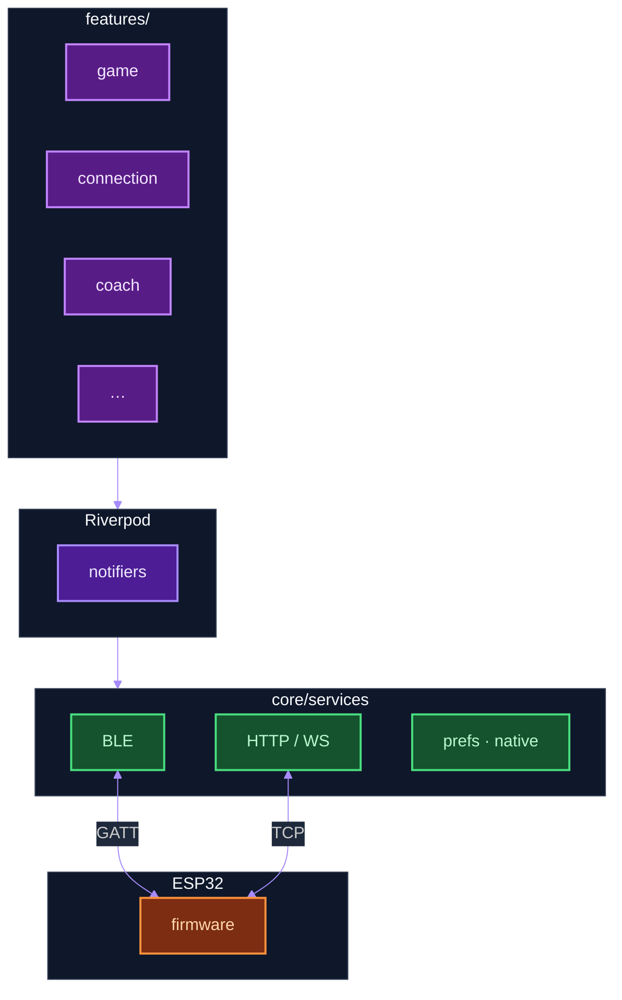
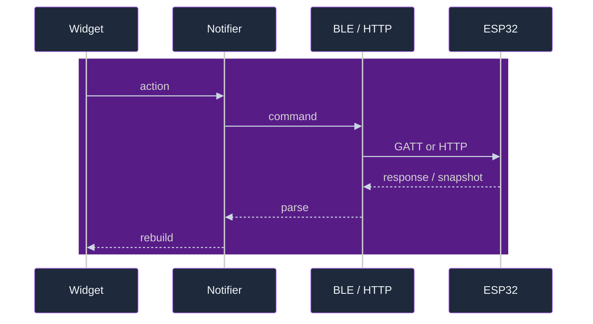
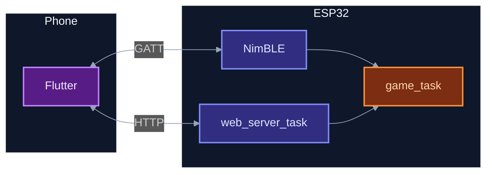
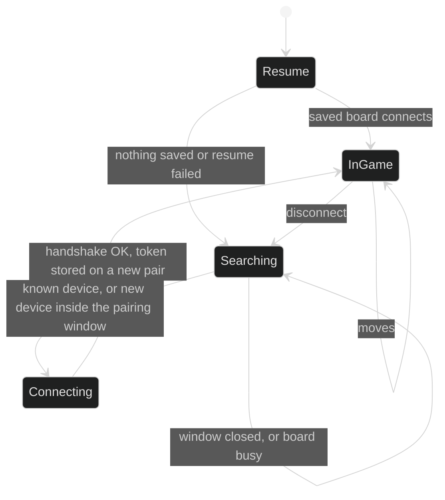
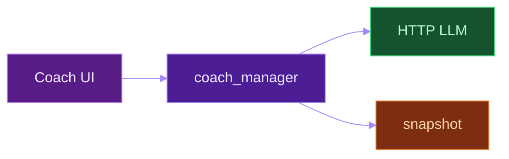

# Flutter client (`flutter_czechmate/`)

[Full repo index](../README.md).

The app supports **BLE** or **HTTP / WebSocket**; state is held via **Riverpod**. On **Windows**, this codebase only implements the network path (no BLE stack in `flutter_blue_plus`). The game itself runs in firmware [`game_task`](../../components/game_task/) — the Dart client synchronizes snapshots and API calls; the `chess` package is used where it helps the UI, not as a replacement for the entire `game_task`.

```bash
cd flutter_czechmate && flutter pub get && flutter run
```

### Windows desktop

- **Prerequisites:** Windows 10/11, [Flutter](https://docs.flutter.dev/get-started/install/windows) on the stable channel, **Visual Studio 2022** with the *Desktop development with C++* workload (CMake, MSVC, Windows SDK).
- **Run:** `flutter pub get && flutter run -d windows`.
- **Release:** `flutter build windows` — the executable is typically in `build/windows/x64/runner/Release/` (copy the entire folder including DLL data).
- **Bluetooth:** the `flutter_blue_plus` library has **no** Windows backend in this project. The client does not call the BLE API; board connection is via **HTTP / WebSocket** (same network as the PC, URL from the board web UI or from the phone after Wi‑Fi setup). BLE scan and OTA over GATT require Android / iOS / macOS / Linux.
- **CI installer:** on push to `main`/`master` that changes `flutter_czechmate/**`, [`.github/workflows/flutter-app-release.yml`](../../.github/workflows/flutter-app-release.yml) runs on GitHub Actions — the `windows` job runs `flutter build windows --release` and packages the output with the Inno Setup script `flutter_czechmate/installer/windows/CzechMateSetup.iss` into `czechmate-<ver>-windows-setup.exe` on Releases.

Release builds: [GitHub Releases](https://github.com/alfredkrutina/chess_esp32_c6_devkit/releases).

New diagram ideas can be tracked locally in `context/diagrams/LOCAL_DIAGRAM_BACKLOG.md`; the template is [DIAGRAM_BACKLOG.local.example.md](../../context/diagrams/DIAGRAM_BACKLOG.local.example.md).

---

## Layers

  
Mermaid: [client_app_layers.mmd](../diagrams/sources/client_app_layers.mmd)

Broader `lib/` map: [flutter_app_structure.svg](../diagrams/flutter_app_structure.svg) · [flutter_app_structure.mmd](../diagrams/sources/flutter_app_structure.mmd)



---

## `lib/`

| Folder | Role |
|--------|------|
| `features/game/` | Play tab: board, both clocks, more sheet (resign, analysis) |
| `features/puzzle/` | Puzzle tab: FEN + line sent to the board |
| `features/learn/` | Learn tab: coach, openings, setup |
| `features/connection/` | Discovery, session, pairing join |
| `features/coach/` | AI chat, LLM (Azure AI Foundry is a provider here, not a screen) |
| `features/analysis/` | Evaluation, opened from Play (not a bottom tab) |
| `features/onboarding/` | First-run flow and the board guide (`board_guide.dart`) |
| `features/settings/` | Device, theme, language, MQTT/HA, OTA (`firmware_update_section`, `firmware_ota_runner`, manifest) |
| `core/services/` | `ble_czechmate_client`, `board_api_client`, `firmware_phone_host_ota`, WS, Stockfish, … |
| `core/models/` | Snapshot, enums |
| `app_providers.dart` | Providers |
| `app_navigation.dart` | Routes |

---

## Command flow to the board



---

## BLE vs HTTP on the board



JSON from BLE often ends up in `web_server_ble_command_dispatch` — same logic as part of the web API.

---

## ESP32 firmware OTA

[context/firmware/ota_architecture.md](../../context/firmware/ota_architecture.md) — HTTPS with STA, HTTP from phone, BLE `OB` chunks, REST, Bearer.

Dart: `BoardSessionNotifier.requestFirmwareOta` / `uploadFirmwareOtaBle`, `FirmwareOtaRunner`, `FirmwarePhoneHostOta`, `BleCzechmateClient.uploadFirmwareBle`.

E2E OTA notes can be kept locally (e.g. a custom checklist); the public channel and API description is in [`context/firmware/ota_architecture.md`](../../context/firmware/ota_architecture.md).

---

## Session and pairing

A saved board reconnects when the main shell starts and again when the app returns to the foreground (`tryResumeFromPrefs`), without opening a pairing window. The first launch shows onboarding before that shell. A new device is accepted only while the board’s 60 s window is open (triple-click; a second triple-click cancels it). The scan response carries company id `0x02E5`, magic `0xC2`, and a status byte: bit 0 pairing, bit 1 a commander already holds the link. The app then either reconnects, pairs, or shows that the board is not in pairing mode or is connected to another device.

Wi‑Fi commands (`POST /api/move`, a command frame on `/ws`) need `Authorization: Bearer` with the 64-hex token issued at pairing (`cmd_ack` `{"code":"paired","api_token":…"}` or `POST /api/pair` while the window is open). The board stores up to three device slots. One commander writes. A different valid token gets `board_busy`. Snapshot GET stays readable without that token. The app has no spectator role.



Code: `board_session_notifier.dart`, `board_pairing.dart`, `features/connection/`, firmware `ble_nimble_impl.c` and `board_pair_policy.c`. Full Czech description: [context/app/deska-a-aplikace.md](../../context/app/deska-a-aplikace.md).

## Puzzle and resign

`POST /api/game/puzzle` (and BLE `{"cmd":"puzzle",...}`) takes `load`, `start`, and `cancel`. `load` stages a FEN and a solver-first UCI line (at most 12 plies, RAM only). The board lights the physical setup and refuses `start` with 409 until the matrix matches, then judges each move immediately. An empty line, once the pieces match, starts an ordinary game from that FEN.

Resign is `{"cmd":"resign","side":"white"|"black"}` and `POST /api/game/resign`. The Play “more” sheet asks for the side to move before sending. The board answers 409 outside a running game and during puzzle, opening trainer, or setup. The 10 s king-lift on the board remains. There is no draw-offer command.

Play layout: four tabs (Play, Puzzle, Learn, Settings). Both clocks stay visible during a game. Coordinates are always drawn. `AppMainTab.analysis` is not a tab; analysis is a pushed route, and the `reportExport*` strings are in the generated localizations.

---

## Coach



Cloud coaches are configured under **Settings → Coach & AI** (priority chain). Stockfish remains the chess-engine path; LLMs only explain.

### Azure AI Foundry

1. Copy [`flutter_czechmate/.env.example`](../../flutter_czechmate/.env.example) to `.env` (or `.env.local`) and fill the placeholders, **or** paste the same values in Settings → Coach & AI → **Azure AI Foundry**.
2. Add **Azure AI Foundry** to the provider priority list and save.
3. Base URL shape expected by the client: `{base}/chat/completions` — use e.g. `https://<resource>.openai.azure.com/openai/v1` (bare host is normalized). Deployment name is sent as JSON `model`. Auth header is `api-key` (not Bearer; Gemma / Google and local Ollama stay on their existing paths).
4. `AZURE_FOUNDRY_API_VERSION` is optional (legacy `…/deployments/<name>` URLs). Settings override `.env` when a field is non-empty.

---

## Native layers

| Platform | |
|-----------|--|
| iOS | Live Activities, Watch |
| Android | Wear, notifications |

---

## Firmware diagrams

[diagrams/README.md](../diagrams/README.md) — tasks, boot, LED pipeline.

[flutter_czechmate/README.md](../../flutter_czechmate/README.md) — short start guide from the app root.
